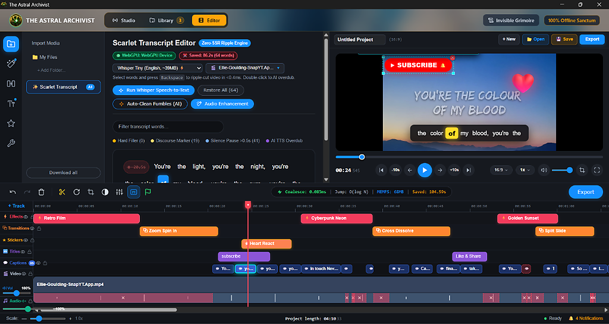
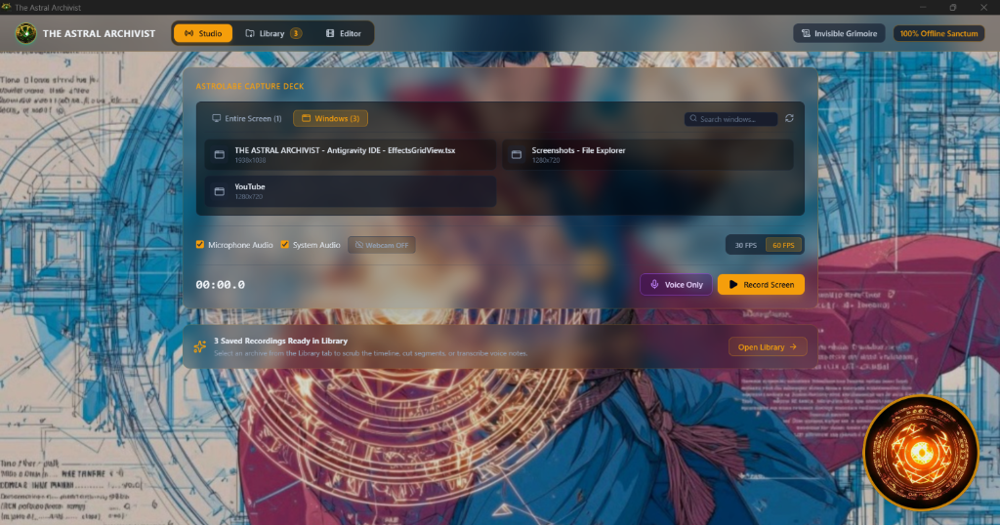
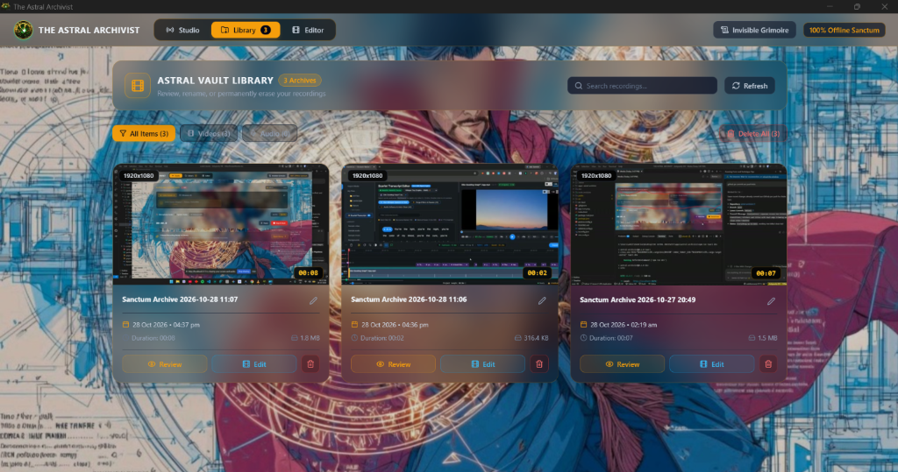
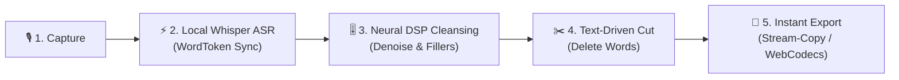

# 🌌 The Astral Archivist

> **Offline celestial screen recorder, encrypted media vault, and AI-accelerated multi-track video editor.**

[](https://tauri.app/)
[](https://react.dev/)
[](https://www.typescriptlang.org/)
[](https://vitejs.dev/)
[](https://tailwindcss.com/)
[](https://huggingface.co/docs/transformers.js)
[-brightgreen.svg)]()
[]()
[](LICENSE)

---

<p align="center">
  <a href="docs/assets/editor-timeline.png">
    
  </a>
</p>

## 🔮 What is The Astral Archivist?

**The Astral Archivist** is an ultra-modern, local-first multimedia creation suite built for creators, educators, and knowledge archivists who refuse to trade privacy for productivity. Powered by **Tauri v2** and **Rust**, it unifies three essential production tools into a single lightning-fast desktop experience:

1. **Astrolabe Capture Studio**: Multi-source screen, window, and voice recorder featuring a sacred circular camera HUD and OS-level private teleprompting.
2. **Astral Vault Library**: A local SQLite-indexed media catalog with instant frame thumbnails, in-app playback, and bulk vault management.
3. **Scarlet Multi-Track NLE Editor**: A professional 7-track non-linear video editor with local WebGPU speech-to-text, transcript-driven cutting, and WebCodecs hardware-accelerated rendering.

**100% Offline. Zero Cloud Subscriptions. Total Data Sovereignty.**

---

## 🏛️ System Architecture

```mermaid
graph TB
    subgraph NativeOS ["🖥️ Native OS Shell (Rust & Tauri v2)"]
        WIN32["Win32 DWM / GDI Window & Screen Enum"]
        AFFINITY["WDA_EXCLUDEFROMCAPTURE (Invisible Prompter)"]
        SQLITE["Embedded SQLite Vault (rusqlite)"]
        FS["Zero-Copy Local Storage Pipeline"]
    end

    subgraph ClientCore ["⚡ Multimedia & Audio Engine (Web APIs)"]
        AUDIOMIX["Web Audio API Multi-Source Mixer (System + Mic)"]
        VUMETER["Live Decibel (dB) Peak Metering"]
        WEBCODECS["WebCodecs Hardware VideoEncoder / AudioEncoder"]
        FFMPEG["FFmpeg WASM & mp4-muxer Export Pipeline"]
    end

    subgraph UserInterface ["✨ Celestial UI (React 19 + TypeScript + Tailwind)"]
        STUDIO["Astrolabe Capture Deck & Sacred Mandala HUD"]
        VAULT["Vault Archive Grid, Player Modal & Bulk Purge"]
        SCARLET["Scarlet 7-Track NLE Timeline (<0.4ms EDL Engine)"]
        WHISPER["On-Device Whisper AI Speech-to-Text (WebGPU INT8)"]
    end

    WIN32 --> STUDIO
    AFFINITY --> STUDIO
    SQLITE <--> VAULT
    FS <--> SCARLET
    AUDIOMIX --> STUDIO
    VUMETER --> STUDIO
    WEBCODECS --> SCARLET
    FFMPEG --> SCARLET
    WHISPER --> SCARLET
```



---

## ✨ Core Pillars & Feature Tour

### 🎙️ 1. Astrolabe Capture Studio

Capture every dimension of your workflow with ultra-low CPU overhead.

<p align="center">
  <a href="docs/assets/capture-studio.png">
    
  </a>
</p>

- **Three Dedicated Capture Modes**:
  - **Screen / Display**: Capture high-refresh primary or secondary monitors with native Win32 GDI enumeration.
  - **Individual Window**: Select any running window with real-time DWM cloaking filters (`DWMWA_CLOAKED`) that omit ghost or minimized background processes.
  - **Voice-Only Note**: Instant high-fidelity audio recorder with live visualizer for podcasting, memos, and voiceovers.
- **Doctor Strange Sacred Mandala Webcam**: Draggable, resizable circular webcam HUD framed with celestial animated golden runes.
- **Invisible Grimoire Teleprompter**: A floating script prompter protected by Windows `SetWindowDisplayAffinity(WDA_EXCLUDEFROMCAPTURE)`. You can read your notes directly off your screen while the recorded video remains completely pristine.
- **Synchronous Dual-Track Audio Mixer**: Web Audio API mixer combining system display audio and microphone input into a phase-aligned stereo stream with live peak dB meters.

---

### 🏛️ 2. Astral Vault Library

Keep your creative archive structured, indexed, and completely private on your local disk.

<p align="center">
  <a href="docs/assets/vault-library.png">
    
  </a>
</p>

- **High-Density Media Cards**: Automatically generated video thumbnails, formatted duration stamps, creation dates, and type badges (Video vs. Audio).
- **In-App Playback Modal**: Full-featured preview monitor with instant scrubbing, timecodes, and waveform visualization.
- **One-Click Timeline Send**: Send any take directly from the Vault into the Scarlet NLE timeline with automatic track placement.
- **Bulk Vault Management**:
  - Search and filter by media type (`All`, `Videos`, `Audio`).
  - Safe individual asset deletion with SQLite cascading cleanup.
  - **"Delete All" Vault Purge**: Clean slate workflow with double-confirmation dialog to safely erase recordings and thumbnails from disk.

---

### ✂️ 3. Scarlet Multi-Track NLE Editor

A desktop-grade non-linear editor engineered for fluid, non-destructive storytelling.

<p align="center">
  <a href="docs/assets/editor-timeline.png">
    
  </a>
</p>

- **7 Dedicated Editing Tracks**:
  - `FX`: Visual Filters & LUTs (Cyberpunk Neon, Vintage Film, Monochrome Noir, Cinematic Warmth, VHS Glitch).
  - `TR`: Video Transitions (Crossfade, Wipe, Zoom, Glitch, Dissolve).
  - `ST`: Overlay Stickers & Graphics (Subscribe badges, Glowing arrows, Fire, Celestial runes).
  - `TT`: Animated Titles & Lower-Thirds.
  - `CC`: Synchronized Captions & Subtitles.
  - `V1`: Primary Video Track with drag-and-drop clip rearrangement and interactive yellow trim handles.
  - `A1`: Audio & Voiceover Track with dedicated volume envelope, mute, and solo switches.
- **On-Device Whisper AI Speech-to-Text**:
  - Powered by `@huggingface/transformers` running quantized INT8 models locally via WebGPU.
  - **Transcript-Driven Video Cutting**: Edit video like a document. Select and delete filler words ("um", "ah", stuttered takes) directly in the text transcript to automatically ripple-slice the underlying video frames in <0.4ms.
- **Dual Video Preview Monitor**:
  - Source Clip Monitor (inspect raw vault footage before placement).
  - Master Program Monitor (real-time canvas composite with applied filters and overlays).
  - SMPTE standard timecode displays (`00:00:00:000`) and interactive zoom (`Ctrl + Wheel`).
- **Flexible Export Engine**:
  - **Lossless Stream-Copy**: Slice and splice identical codecs instantly without re-encoding (`-c copy`).
  - **WebCodecs Hardware Acceleration**: High-speed MP4/H.264 rendering with client-side container multiplexing (`mp4-muxer`).

---

## 🔮 Sovereign AI Workflow (Edit Video Like Text)

Edit your video narrative seamlessly in three synchronized, 100% offline stages:



| Stage | Process | Key Highlight |
| :--- | :--- | :--- |
| **1. Speech-to-Text** | Quantized INT8 Whisper via WebGPU/WASM | Generates word-level timestamps with **zero cloud latency or privacy leaks**. |
| **2. Audio Cleansing** | Spectral gating & neural disfluency classification | Auto-flags filler sounds (*"um"*, *"uh"*, pauses >0.5s) and dynamically ducks background music. |
| **3. Transcript Cutting** | Highlight text or click **"Purge All Fillers"** | Argon ADR-001 math engine ripples all 7 tracks in **<0.4ms** non-destructively. |

> [!TIP]
> **Pro Workflow**: Skim the transcript and press `Delete` on any hesitations or bad takes. The video tightens instantly across all 7 tracks without manual razor cuts.

---

## 🛠️ Technology Stack

| Layer | Technology | Version | Purpose |
| :--- | :--- | :--- | :--- |
| **Desktop Shell** | [Tauri](https://tauri.app/) | `v2.0` | Secure Rust-based native windowing, low RAM footprint, OS capabilities |
| **OS Integration** | [windows-rs](https://github.com/microsoft/windows-rs) | `0.58` | Win32 DWM cloaking, GDI monitor enumeration, capture affinity |
| **Database** | [rusqlite](https://github.com/rusqlite/rusqlite) | `0.32` | Bundled embedded SQLite database for vault media cataloging |
| **Async Runtime** | [tokio](https://tokio.rs/) | `1.40` | High-throughput asynchronous Rust backend execution |
| **Frontend UI** | [React](https://react.dev/) | `19.0` | Reactive component tree and modern concurrency |
| **Bundler & Tooling** | [Vite](https://vitejs.dev/) | `6.0` | Sub-millisecond HMR and optimized production bundle |
| **Language** | [TypeScript](https://www.typescriptlang.org/) | `5.7` | Strict end-to-end type safety across IPC and EDL models |
| **Styling** | [Tailwind CSS](https://tailwindcss.com/) | `3.4` | Custom celestial dark aesthetic, glassmorphism, glowing accents |
| **State Management** | [Zustand](https://github.com/pmndrs/zustand) | `5.0` | Decoupled reactive state for Studio, Vault, and Timeline engines |
| **On-Device AI** | [@huggingface/transformers](https://huggingface.co/docs/transformers.js) | `4.3` | Client-side Whisper speech-to-text with WebGPU acceleration |
| **Video Encoding** | [WebCodecs API](https://developer.mozilla.org/en-US/docs/Web/API/WebCodecs_API) | Native | Hardware-accelerated `VideoEncoder` & `AudioEncoder` |
| **Container Muxing**| [mp4-muxer](https://github.com/Vanilagy/mp4-muxer) | `5.2` | Fast client-side MP4 container creation |
| **WASM Processing** | [@ffmpeg/ffmpeg](https://ffmpegwasm.netlify.app/) | `0.12` | In-browser transcoding and format normalization |
| **Iconography** | [Lucide React](https://lucide.dev/) | `1.16` | Consistent, accessible vector icon suite |

---

## ⌨️ Keyboard Shortcuts & Workflow

| Shortcut | Context | Action |
| :--- | :--- | :--- |
| `Space` | Global / Editor | Play / Pause master timeline or preview monitor |
| `C` / `Ctrl + B` | Timeline | Razor split active clip at playhead position |
| `Delete` / `Backspace` | Timeline | Ripple delete selected clip / block |
| `Ctrl + Z` | Editor | Undo last timeline edit or trim |
| `Ctrl + Y` / `Ctrl + Shift + Z` | Editor | Redo timeline action |
| `Ctrl + Scroll Wheel` | Timeline | Zoom timeline in / out smoothly |
| `J` / `K` / `L` | Player | Shuttle reverse, pause, shuttle forward |
| `Home` / `End` | Timeline | Jump playhead to beginning / end of sequence |

---

## 🚀 Getting Started

### Prerequisites

Ensure you have the following installed on your development workstation:
- **Node.js**: v18.0 or later (v20+ recommended)
- **Rust Toolchain**: `rustc` and `cargo` (1.77+ stable) — [Install Rust](https://www.rust-lang.org/tools/install)
- **Windows Build Tools**: C++ Build Tools installed via Visual Studio Installer (for Windows users)

### 1. Clone the Repository

```bash
git clone https://github.com/aksjc2023-code/astral-archivist.git
cd astral-archivist
```

### 2. Install Dependencies

```bash
npm install
```

### 3. Launch Development Server

Run the Vite dev server alongside the native Tauri v2 desktop shell:

```bash
npm run tauri dev
```

*Note: On first run, Cargo will download and compile the Rust dependencies. Subsequent hot reloads compile in milliseconds.*

### 4. Run Automated Test Suite

Execute the dual-engine test suite covering mathematical EDL slicing and backend persistence:

```bash
# Run Vitest unit tests (Argon ADR-001 math engine & binary cursors)
npm test

# Run Rust SQLite vault and CRUD integration tests
cd src-tauri && cargo test
```

### 5. Build Production Release

Generate an optimized, standalone desktop installer:

```bash
# Type check and build Vite frontend
npm run build

# Compile release binary and installer via Tauri
npm run tauri build
```

The compiled binaries will be output to `src-tauri/target/release/bundle/`.

---

## 🛡️ Security, Privacy & Data Sovereignty

- **100% Air-Gapped Capable**: The Astral Archivist does not send telemetry, analytics, or media to external servers. All recordings, transcripts, and edits live on your local machine.
- **Affinity Privacy Shielding**: The Grimoire script prompter utilizes the native Windows OS flag `WDA_EXCLUDEFROMCAPTURE`. Even when recording your full desktop, your private scripts and notes are physically excluded by the Windows Desktop Window Manager (DWM).
- **Non-Destructive EDL Architecture**: Edits, trims, and cuts are stored as non-destructive Edit Decision Lists (EDL). Your original recordings remain unaltered in the vault until you explicitly choose to delete them.

---

## 🤝 Contributing

Contributions, issues, and feature proposals are welcome!
1. Fork the Project.
2. Create your Feature Branch (`git checkout -b feature/CelestialFeature`).
3. Commit your Changes (`git commit -m 'feat: add celestial ripple enhancement'`).
4. Push to the Branch (`git push origin feature/CelestialFeature`).
5. Open a Pull Request.

---

## 📜 License

This project is open-source software licensed under the [MIT License](LICENSE).

---

<p align="center">
  <sub>Crafted with 🌌 by <b>The Astral Archivist Team</b>. Empowering sovereign storytelling.</sub>
</p>
